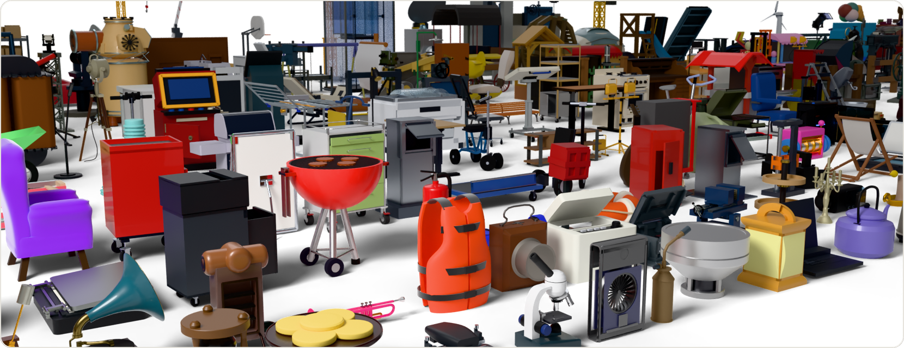
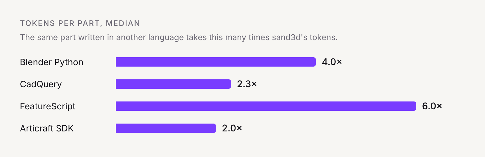
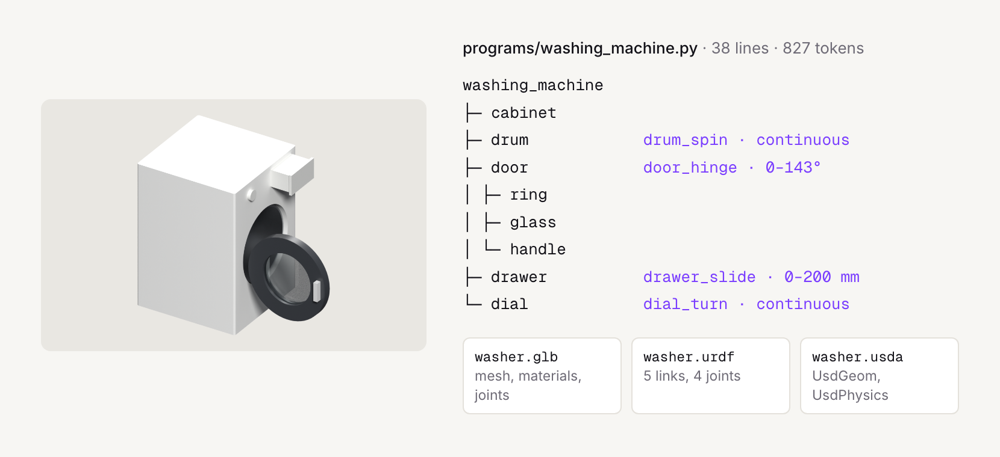
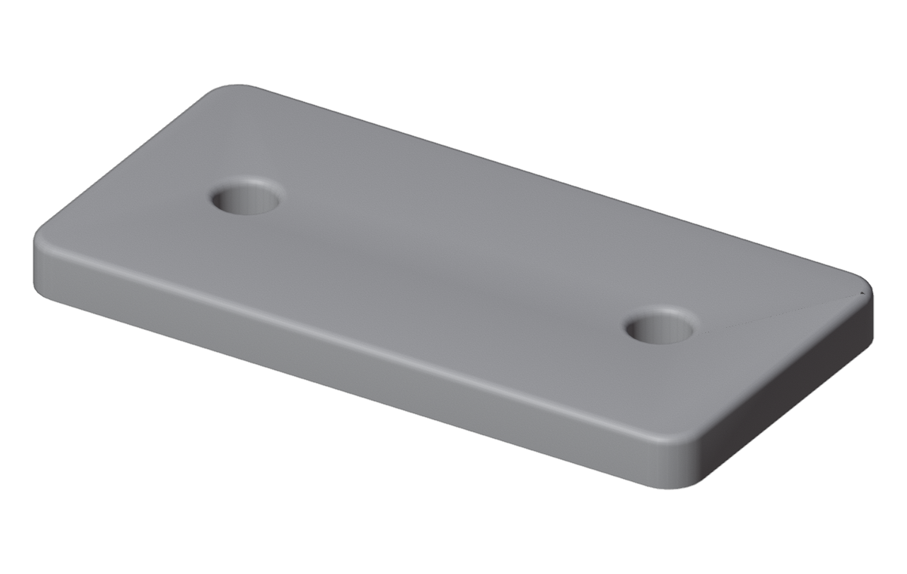

<h1>
  <picture>
    <source media="(prefers-color-scheme: dark)" srcset="docs/readme/sandflow-symbol-white.svg">
    
  </picture>
  &nbsp;sand3d
</h1>

**3D modeling in Python, built for LLMs.**

sand3d is a Python library for writing 3D objects as short programs: profiles, solids,
edits, frames, joints and assemblies, over Blender's `bpy`. A program says *how* a shape
is made, part by part and in its own words, so a model writes it in a few hundred tokens
and a person can read it.

<p align="center"></p>

<p align="center">
  <a href="https://sand3d.sandflow.ai/">Website</a> ·
  <a href="https://sand3d.sandflow.ai/api.html">API for LLMs</a> ·
  <a href="https://sand3d.sandflow.ai/guidelines.html">Writing an assembly</a> ·
  <a href="https://sand3d.sandflow.ai/#export">Export</a> ·
  <a href="https://sand3d.sandflow.ai/#citation">Citation</a>
</p>

<p align="center">
  <a href="LICENSE"></a>
  
  
  <a href="https://github.com/Sandflow-ai/sand3d/actions/workflows/tests.yml"></a>
</p>

## Why sand3d

<p align="center"><br>
<a href="https://sand3d.sandflow.ai/tokens.html">How it is measured, part by part</a></p>

- **Short.** A part takes 2 to 6× fewer tokens than the same part in Blender Python, CadQuery or FeatureScript ([details](https://sand3d.sandflow.ai/tokens.html)).
- **The whole API fits in a prompt**, about 3,600 tokens ([the API](https://sand3d.sandflow.ai/api.html)).
- **Named, not computed.** Parts, edges and faces are reached by name, never by hand-computed coordinates.
- **Deterministic.** The same program builds the same mesh, bit for bit.

## A whole object, part by part

<p align="center"></p>

A front-loading washing machine in 38 lines of code ([play it and read it](https://sand3d.sandflow.ai/gallery.html)):
the cabinet, the drum, the door with its glass and handle, the detergent drawer and the dial,
each a named part, and four joints that say how they move.

```python
door = s3d.group("door", ring, glass, handle)                      # the handle and the glass move with it
s3d.joint("door_hinge", door, hinge, axis="-Z", range=(0, 143))
s3d.joint("drum_spin", drum, front.move(0, 400), kind="continuous")
s3d.joint("drawer_slide", drawer, top_band.move(150), kind="prismatic", axis="+X", range=(0, 200))
s3d.joint("dial_turn", dial, top_band.move(-150), kind="continuous")
return s3d.assembly("washing_machine", cab, drum, door, drawer, dial, front=front)
```

## Export: GLB, URDF, USD, OBJ, STL

One call; the file's extension names the format; lengths in metres.

```python
s3d.export(machine, "washer.glb")    # or .urdf, .usda, .obj, .stl
```

| format | what it carries | for |
|---|---|---|
| **GLB** | meshes, materials, the joints in each node's extras, at the current pose | the web, viewers, game engines |
| **URDF** | a link per moving part, its joints and their limits, at rest; OBJ meshes beside it | ROS, PyBullet, MuJoCo, Isaac |
| **USDA** | the same tree in OpenUSD (UsdGeom, UsdPhysics), with the materials | Omniverse, Isaac Sim, USD pipelines |
| **OBJ**, **STL** | the meshes alone, at the current pose: OBJ Y up, binary STL Z up | any 3D tool, slicers |

`.usd`, `.usdc` and `.usdz` come from the `.usda` through USD's own tools (`usdcat`,
`usdzip`). The scene is also an ordinary Blender scene, for anything else Blender writes.

## Install

Python 3.13 (recommended) or 3.11. Blender comes with it, as the `bpy` module: 5.2 LTS on
Python 3.13, 4.5 LTS on Python 3.11, the two versions the tests run on.

```bash
pip install sand3d        # or, in a uv project: uv add sand3d
```

`bpy` has no wheel for Python 3.12, nor for Intel Macs from 5.2 on: there, use Python 3.11.

## A first program



```python
import sand3d as s3d

def bracket(w=80, d=40, t=6, hole_d=6.6, pitch=50):
    plate = s3d.extrude("plate", s3d.rect(w, d, r=4), t)
    s3d.hole(plate, hole_d, on=s3d.grid(2, 1, pitch, 0))
    s3d.fillet(plate, 1, edges="top")
    return plate

s3d.export(bracket(), "bracket.glb")
```

Millimetres by default. Every verb with code that runs and its render: [the quickstart](https://sand3d.sandflow.ai/quickstart.html);
objects to play joint by joint: [the gallery](https://sand3d.sandflow.ai/gallery.html); every signature: [the API](https://sand3d.sandflow.ai/api.html).
The programs themselves: [docs/examples/](docs/examples/) and [programs/](programs/).

## Give it to your LLM

Put [docs/api.md](docs/api.md) in the system prompt: the rules of the vocabulary, every
signature, and worked examples, in about 3 600 tokens; [llms.txt](llms.txt) points a
model at it. For objects of several parts, [the guidelines](https://sand3d.sandflow.ai/guidelines.html) give
the eight rules of an assembly program: the plan first, then the details, then the parts.

## What is in it

Everything on one flat `s3d.<verb>` surface:

| family | verbs |
|---|---|
| profiles | `rect` `circle` `slot` `polygon` `poly` `arc` `spline` `superellipse` `text` `offset` `stroke` … (16) |
| solids and paths | `extrude` `revolve` `sweep` `loft` `wire` `helix` `box` `cylinder` `tube` `sphere` `torus` `dome` … (15) |
| edits | `cut` `join` `intersect` `split` `hole` `pocket` `fillet` `chamfer` `shell` `dent` … (15) |
| frames and placement | `Frame` `face` `edge` `bbox` `local` `at` `transform` `grid` `ring` `along` `snap` |
| articulation | `joint` `pose` `seat` |
| assembly | `group` `assembly` `attach` `export` `units` `fingerprint` … (8) |
| parts and materials | `gear` `knurl` `thread` `material` |

No category verbs (`chair()`, `table()`): a category is a program written *in* sand3d.

## Citation

If you use sand3d in your work, please cite it. `CITATION.cff` holds the same, and GitHub
shows it as "Cite this repository".

```bibtex
@misc{sand3d2026,
  author = {Neveu, Thibault and Loy, Andr{\'e}a},
  title  = {sand3d},
  year   = {2026},
  note   = {Version 1.6.1},
  url    = {https://github.com/Sandflow-ai/sand3d}
}
```

## Contributing and license

How the library is built, tested and versioned: [CONTRIBUTING.md](CONTRIBUTING.md).
Apache License 2.0: see [LICENSE](LICENSE).
